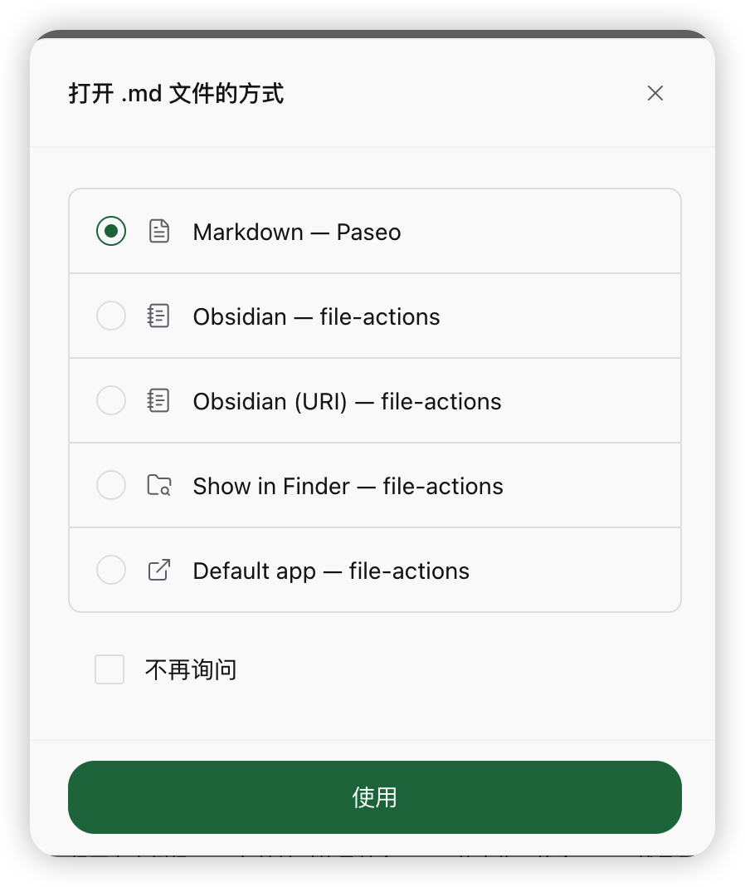

# File Actions

A [Paseo](https://paseo.sh) plugin that adds your own actions to the **Open with…** menu of a file tab.
Pick one and the tab shows a preview of the file with a button that runs your action on it, for example
opening a Markdown note in Obsidian, showing the file in Finder, or running a terminal command.



## Install

```bash
paseo plugin add guoguoguilai/file-actions
```

Requires Paseo 0.14.0 or later. The built-in actions are for macOS.

## Use

1. Right-click a file tab and choose **Open with…**, then pick an action.
2. The tab shows the file and an action bar. Press the button to run the action.
3. Tick **Don't ask again** in the picker to make a file type always open this way.

Built-in actions: **Obsidian** (uses the Obsidian command line, so turn on Settings > General > Advanced >
Command line interface), **Obsidian (URI)**, **Show in Finder**, **Default app**.

## Add your own action

Open the plugin settings and choose **Add action**.

| Field | Example |
| --- | --- |
| Name | `VS Code` |
| Program | `/usr/bin/open` |
| Arguments | `-a "Visual Studio Code" {path}` |
| File types | `md, txt, json` |

Placeholders, each filling one argument: `{path}`, `{dir}`, `{name}`, `{ext}`, `{vault}`, `{relPath}`,
`{uriPath}`. The program starts directly, without a shell, so paths with spaces stay intact.

## Security

The program runs on the machine that runs the Paseo daemon, with that user's rights, and only for actions
you configured. The plugin reads the path and content of the file in the tab to draw the preview. It sends
nothing over the network.

## Develop

```bash
npm install
npm run typecheck
paseo plugin install .
```

Licensed under MIT.
